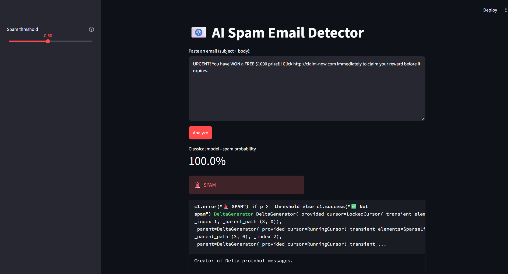
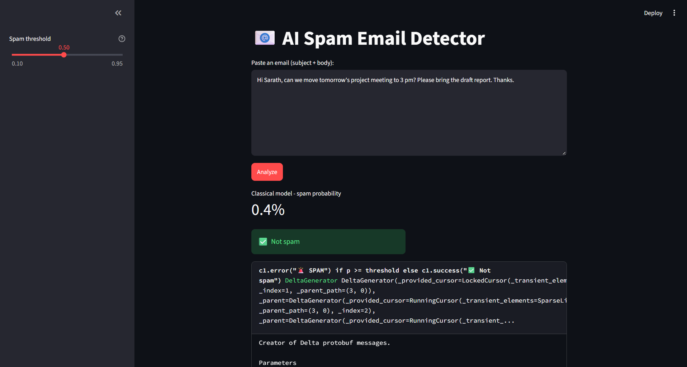
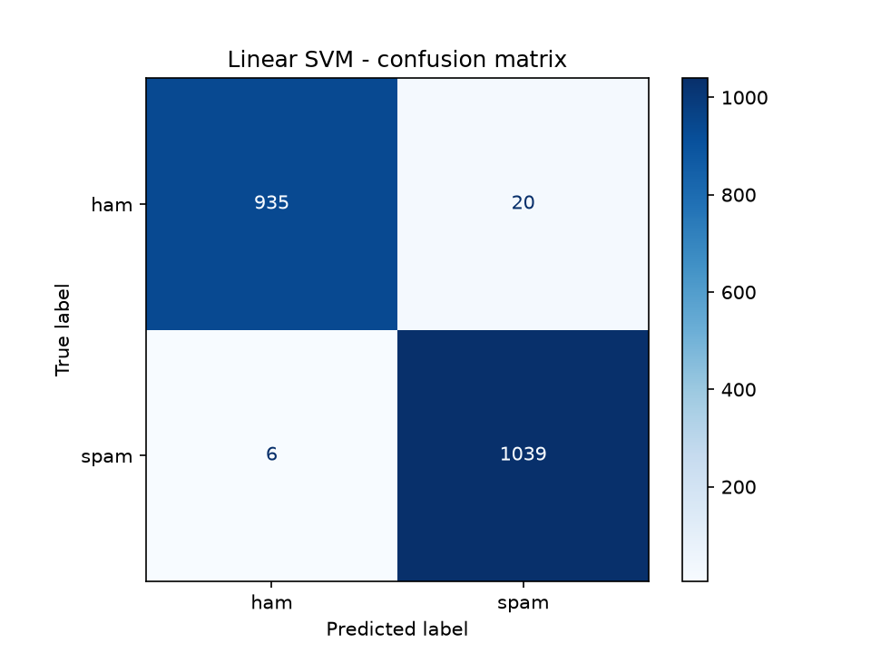
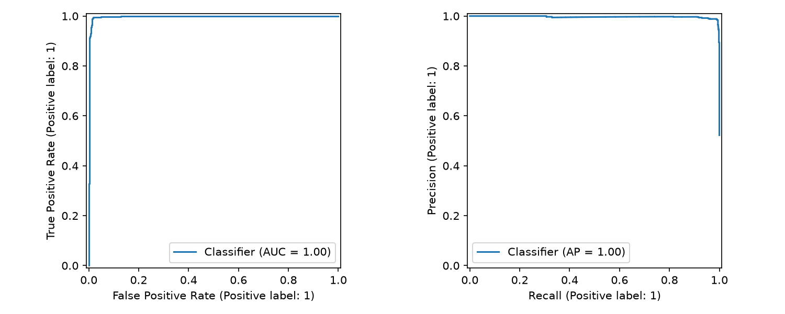

# AI-Based Spam Email Detection

A machine learning project that classifies emails as **spam** or **not spam (ham)** from their text. It compares four classical models on TF-IDF and hand-crafted features, evaluates the best one on a held-out test set, and ships with an interactive **Streamlit web app** that explains *why* an email was flagged. An optional **DistilBERT** fine-tuning script is included for a deep-learning comparison.

Built as part of the Kodacy x SPACE (Scientific Platforms And Cosmic Explorations) 30-day virtual internship on Artificial Intelligence and Machine Learning.

---

## Table of contents

1. [Highlights](#highlights)
2. [Demo](#demo)
3. [Dataset](#dataset)
4. [Project structure](#project-structure)
5. [How it works](#how-it-works)
6. [Results](#results)
7. [Getting started](#getting-started)
8. [Usage](#usage)
9. [Design decisions](#design-decisions)
10. [Limitations](#limitations)
11. [Future work](#future-work)
12. [Author](#author)

---

## Highlights

- Compares **4 models** (Naive Bayes, Logistic Regression, Linear SVM, Random Forest) with **5-fold stratified cross-validation**
- Combines **word n-gram TF-IDF**, **character n-gram TF-IDF** and **6 hand-crafted spam signals**
- Reports **precision, recall and F1**, not just accuracy, because a false positive (a real email sent to spam) is the costly mistake
- **Adjustable spam threshold** in the app, backed by a threshold sweep (`results/threshold_sweep.csv`)
- **Explainability**: a per-email chart of the words pushing the decision towards spam or legitimate
- **Error analysis**: every misclassified test email is saved to `results/misclassified.csv`
- Optional **DistilBERT** fine-tuning script (GPU recommended)

---

## Demo

Run the app locally (see [Getting started](#getting-started)), paste an email and click **Analyze**.

<!-- Add your screenshots to a screenshots/ folder and keep these lines -->
| Spam example | Legitimate example |
|---|---|
|  |  |

Example inputs used while testing:

- Spam: `URGENT! You have WON a FREE $1000 prize!!! Click http://claim-now.com immediately to claim your reward before it expires.` -> **100.0% spam**
- Legitimate: `Hi Sarath, can we move tomorrow's project meeting to 3 pm? Please bring the draft report. Thanks.` -> **0.4% spam**

---

## Dataset

| Property | Value |
|---|---|
| Source | [Spam Email Classification Dataset (Kaggle)](https://www.kaggle.com/datasets/purusinghvi/email-spam-classification-dataset) |
| Total emails | 83,448 |
| Spam (label `1`) | 43,910 |
| Not spam (label `0`) | 39,538 |
| Missing values | 0 |
| Duplicate rows | 0 |
| Columns | `label`, `text` |

The classes are fairly balanced (about 52.6% spam), so accuracy is not misleading here, but precision and recall are still reported separately.

**Training sample:** the results below come from a random sample of **10,000 emails** (52.2% spam), split 80/20 into 8,000 training and 2,000 test emails with stratification. The full dataset is about 140 MB and is **not included in this repository** (it is listed in `.gitignore`). To reproduce the results, download it yourself and place it in `data/`.

---

## Project structure

```
spam-email-detection/
├── app.py                 # Streamlit web app
├── train_classical.py     # Trains and compares the classical models
├── train_bert.py          # Optional DistilBERT fine-tuning (GPU recommended)
├── requirements.txt       # Python dependencies
├── results/               # Generated by train_classical.py
│   ├── cv_comparison.csv      # Cross-validation scores for all models
│   ├── confusion_matrix.png   # Test-set confusion matrix
│   ├── roc_pr.png             # ROC and precision-recall curves
│   ├── misclassified.csv      # Test emails the best model got wrong
│   ├── threshold_sweep.csv    # False positives/negatives at each threshold
│   └── top_words.csv          # Words most associated with spam and ham
├── screenshots/           # App screenshots used in this README
├── data/                  # NOT in the repo - put spam.csv here
└── models/                # NOT in the repo - created by training
```

---

## How it works

### 1. Preprocessing and features

Each email goes through a feature union of three parts:

| Feature set | Details |
|---|---|
| Word TF-IDF | Unigrams and bigrams, English stop words removed, `min_df=2`, sublinear term frequency |
| Character TF-IDF | 3-5 character n-grams within word boundaries, `min_df=3`. This helps catch obfuscated spelling such as "fr33" or "c1ick" |
| Hand-crafted signals | Email length, number of URLs, number of `!`, share of uppercase letters, share of digits, and a flag for words like *free*, *win*, *prize*, *urgent*, *click* or a currency symbol (all scaled 0-1) |

### 2. Models compared

| Model | Notes |
|---|---|
| Multinomial Naive Bayes | Fast probabilistic baseline (`alpha=0.1`) |
| Logistic Regression | `C=10`, balanced class weights |
| Linear SVM | Wrapped in `CalibratedClassifierCV` so it outputs probabilities |
| Random Forest | 200 trees, balanced class weights |

### 3. Evaluation

1. Hold out 20% of the data as a test set (stratified).
2. Run **5-fold stratified cross-validation** on the remaining 80% for every model, scoring precision, recall and F1.
3. Pick the model with the best mean cross-validated F1.
4. Retrain it on the full training split and evaluate once on the test set.
5. Save plots, misclassified emails, a threshold sweep and the most influential words.

### 4. Explainability

A separate word-level Logistic Regression model is trained alongside the best model. For each email, the app multiplies each word's TF-IDF value by its learned weight and plots the strongest contributors. Positive bars push towards spam, negative bars towards legitimate.

---

## Results

All numbers are from the 10,000-email sample.

### Cross-validation (5-fold, training split)

| Model | Precision | Recall | F1 | F1 std |
|---|---|---|---|---|
| **Linear SVM** | 0.9836 | 0.9895 | **0.9865** | 0.0023 |
| Logistic Regression | 0.9788 | 0.9931 | 0.9859 | 0.0015 |
| Random Forest | 0.9625 | 0.9888 | 0.9754 | 0.0025 |
| Naive Bayes | 0.9863 | 0.9636 | 0.9748 | 0.0012 |

### Held-out test set (Linear SVM, 2,000 emails)

| Class | Precision | Recall | F1 | Support |
|---|---|---|---|---|
| Not spam | 0.9936 | 0.9791 | 0.9863 | 955 |
| Spam | 0.9811 | 0.9943 | 0.9876 | 1,045 |
| **Accuracy** | | | **0.9870** | 2,000 |

In plain terms, on the test set about 20 legitimate emails were wrongly flagged as spam and about 6 spam emails slipped through (derived from the precision and recall above; see the confusion matrix for exact counts).




### Observations

- The two linear models (Linear SVM and Logistic Regression) lead on this high-dimensional sparse text data, and their scores are very close.
- Naive Bayes has the highest precision but the lowest recall, so it lets more spam through.
- Random Forest is the slowest to train and does not beat the linear models on sparse TF-IDF features.
- Logistic Regression has the highest recall (0.9931), which matters if missing spam is the bigger concern.
- DistilBERT results are not included yet (see [Future work](#future-work)).

---

## Getting started

### Requirements

- Python 3.9 or newer (developed on Python 3.13)
- Git
- About 2 GB of free disk space for packages

### Installation (Windows)

```
git clone https://github.com/kanth2003/spam-email-detection.git
cd spam-email-detection
python -m venv venv
venv\Scripts\activate
pip install pandas numpy scikit-learn matplotlib joblib streamlit
```

On macOS or Linux, activate the environment with `source venv/bin/activate` instead.

For the optional DistilBERT script you also need `torch transformers datasets accelerate`. These are large, so a GPU environment such as Google Colab is recommended.

### Get the data

1. Download the dataset from the source listed in [Dataset](#dataset).
2. Make sure it has the columns `text` and `label` (labels `1`/`0` or `spam`/`ham`).
3. Save it as `data/spam.csv`.

For a quick test run on a smaller sample:

```
python -c "import pandas as pd; df = pd.read_csv('data/spam.csv').dropna().drop_duplicates(); df.sample(10000, random_state=42).to_csv('data/sample.csv', index=False)"
```

---

## Usage

### Train and compare the classical models

```
python train_classical.py data/sample.csv
```

Use `data/spam.csv` instead for the full dataset. Training on all 83,448 long emails is much slower, and Random Forest in particular needs a lot of time and memory. This creates `models/` and `results/`.

### Run the web app

```
streamlit run app.py
```

Paste an email, click **Analyze**, and read the spam probability, the verdict and the word-contribution chart. Use the sidebar slider to change the spam threshold. A higher threshold means fewer legitimate emails are flagged, at the cost of letting more spam through.

### (Optional) Fine-tune DistilBERT

```
python train_bert.py data/sample.csv
```

Run this on a GPU. It saves the model to `models/bert`, and the app then shows a second probability from DistilBERT next to the classical model.

---

## Design decisions

- **F1, precision and recall over accuracy.** A spam filter that hides a real email is worse than one that lets a spam through, so errors are examined by type.
- **Character n-grams.** Spammers deliberately misspell words. Character-level features are more robust to that than word features alone.
- **Calibrated probabilities.** Linear SVM does not output probabilities by default, so it is calibrated. This makes the threshold slider in the app meaningful.
- **Separate explainability model.** The best classifier uses many combined features, which are hard to interpret. A simple word-level Logistic Regression gives readable, per-word contributions.
- **Data and models kept out of Git.** The dataset (about 140 MB) exceeds GitHub's 100 MB file limit and models can be regenerated from the scripts.

---

## Limitations

- Results come from a **10,000-email sample** of a single dataset. Scores on other datasets, languages or newer spam styles will likely be lower.
- The classes are fairly balanced here, while real inbox traffic usually contains far more legitimate email than spam.
- Only the **email text** is used. Sender address, headers, attachments and link reputation are ignored.
- The model has not been tested against **adversarial spam** written specifically to evade it.
- The explainability chart comes from a simpler model than the one that makes the final decision, so it is an approximation.

---

## Future work

- Train on the **full 83,448 emails** and compare against the sample results
- Run and report the **DistilBERT** comparison
- Test on a **second, different dataset** to measure generalisation
- Add **header and URL features** (sender domain, reply-to mismatch, link analysis)
- Run an **adversarial test** with obfuscated words
- **Deploy** the app on Streamlit Community Cloud or Hugging Face Spaces

---

## Author

**Kommi Chandrakanth** - [GitHub: kanth2003](https://github.com/kanth2003)

Completed as part of the Kodacy x SPACE virtual internship on Artificial Intelligence and Machine Learning (certificate completed October 2, 2026).
